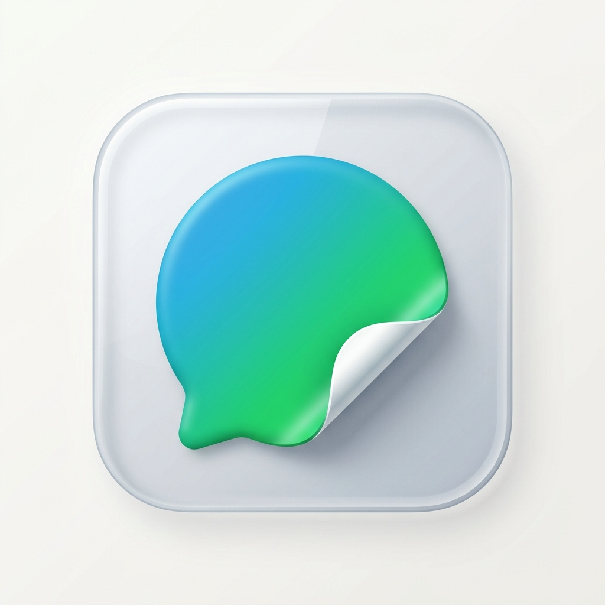

<div align="center">



# TeleToWA

**Telegram → WhatsApp Sticker Converter**

Fetch any Telegram sticker pack, convert animated & static stickers, and export directly to WhatsApp — all from one app.

<br/>


</div>

## [+] How It Works

> Paste a Telegram sticker pack link → Download → Preview → Convert → Add to WhatsApp

The app fetches sticker metadata via the Telegram Bot API, downloads all stickers, converts `.webm` video stickers to animated WebP using a high-performance native Rust engine, and serves them to WhatsApp through a ContentProvider following the [official WhatsApp Sticker API](https://github.com/WhatsApp/stickers).

## [+] Features

- **Blazing Fast Native Rust Engine** : ultra-lightweight `.webm` (VP9) to animated WebP conversion without heavy bloat
- **Animated & Static** : handles video (`.webm`) and image (`.webp`) stickers from Telegram
- **Smart Pack Splitting** : auto-separates animated (max 30) and static (max 50) into valid WhatsApp packs
- **WhatsApp + Business** : export to both WhatsApp and WhatsApp Business
- **Gallery Import** : add your own images to any pack before converting
- **Dark Mode** : light, dark, and system-default themes
- **Transparent Padding** : non-square stickers keep transparency, no black bars
- **Configurable** : pack size limit, author name, bot token — all from settings

## [+] Setup

<details>
<summary><strong>1. Get a Telegram Bot Token</strong></summary>

<br/>

1. Open Telegram and search for **@BotFather**
2. Send `/newbot` and follow the prompts
3. Copy the token (looks like `123456789:ABCDefGhI...`)

The bot is only used to access the Telegram API — it doesn't need to be added to any group.

</details>

<details>
<summary><strong>2. Build & Run</strong></summary>

<br/>

```bash
git clone https://github.com/gunjanmistry08/TeleToWA.git
cd TeleToWA
```

Open in Android Studio → Build → Run on device.

</details>

<details>
<summary><strong>3. First Launch</strong></summary>

<br/>

The app walks you through a two-step onboarding:

1. Paste your Telegram Bot Token
2. Enter your name (appears as publisher on WhatsApp packs)

Both can be changed later in Settings.

</details>

## [+] Building the APK

```bash
# Debug build
./gradlew assembleDebug

# Release build
./gradlew assembleRelease -x lintVitalAnalyzeRelease -x lintVitalReportRelease -x lintVitalRelease
```

Output: `app/build/outputs/apk/release/app-release.apk`

## [+] License

This project is licensed under the [MIT License](LICENSE).
